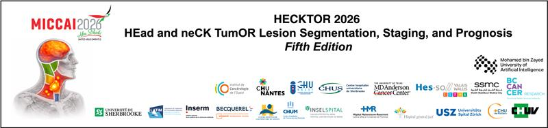
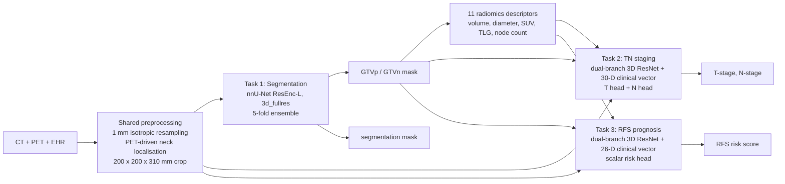

<div align="center">



# R2SNet

### A Dual-Branch Fusion Pipeline for Head and Neck Tumor Segmentation, TN Staging, and Recurrence-Free Survival Prediction

**HECKTOR 2026 Challenge · Conference paper at MICCAI 2026**
📍 Strasbourg, France

[](https://papers.miccai.org/miccai-2026-sat/paper/HECKTOR_014.pdf)
[](#-publication)
[](https://papers.miccai.org/miccai-2026-sat/paper/HECKTOR_014.pdf)
[](#-getting-started)
[](#-getting-started)
[](LICENSE)

**Ikram Aissiou¹. Naima Boukhiar¹· Ahmed Riadh Fellah¹ · Sam Guessoum² **

<sub>¹ Department of Computer Science, University of Algiers 1, Algeria &nbsp;|&nbsp; ² Department of Computer Science, Worcester Polytechnic Institute, USA</sub>

</div>

---

## 📌 TL;DR

HECKTOR 2026 asks for three linked outputs from a single PET/CT study of a head and neck cancer patient: **tumor segmentation** (GTVp / GTVn), **TN staging**, and **recurrence-free survival (RFS)** prognosis. Team **R2SNet** treats them as one pipeline rather than three separate problems:

1. **One shared preprocessing stage** (resampling, PET-driven neck localisation, fixed crop) computed once per case, which keeps end-to-end inference inside the challenge's **25-minute / 16 GiB (T4)** budget.
2. **One reusable dual-branch fusion backbone** (3D image + mask branch fused with a clinical/radiomics vector) used for both staging and prognosis, with different heads.
3. **Task-specific radiomics conventions**, kept deliberately separate because each head was trained against its own feature definitions.

### Validation-phase results

| Task | Metric | Score |
|---|---|:---:|
| Segmentation (GTVp / GTVn) | Mean Dice | **0.6194** |
| T-stage classification | Balanced accuracy | **0.4827** |
| N-stage classification | Balanced accuracy | **0.6721** |
| RFS prognosis | Concordance index | **0.6964** |
| **Overall (official weighted score)** | 0.25·Dice + 0.35·mean(T, N BAcc) + 0.40·C-index | **0.6355** |

> Testing-phase figures are released by the organisers and will be added here and in the camera-ready paper.

---

## 🏆 Publication

**A Dual-Branch Fusion Pipeline for Head and Neck Tumor Segmentation, TN Staging, and Recurrence-Free Survival Prediction: HECKTOR 2026**


- 🎤 HECKTOR 2026 Challenge paper, presented at **MICCAI 2026**, Strasbourg, France
- 📄 [Read the paper (PDF)](https://papers.miccai.org/miccai-2026-sat/paper/HECKTOR_014.pdf)
- 👥 Team name: **R2SNet**

---

## 🏗️ Pipeline



### Stage by stage

| Stage | What it does |
|---|---|
| **Preprocessing** | CT and PET are resampled onto the intersection of their bounding boxes at **1 mm isotropic** spacing (B-spline). If direct resampling fails because of header mismatch, a **rigid registration fallback** (Euler 3D, Mattes mutual information, multi-resolution gradient descent) aligns PET to CT first. The head-and-neck region is localised from PET intensity: in the upper quarter of the volume, voxels with z-score > 1 are thresholded, the largest 26-connected component gives the centre, and a **200 × 200 × 310 mm** box is cropped. Follows the logic of the [HECKTOR 2025 MEDAI baseline](https://github.com/Liiiii2101/HECKTOR2025-MEDAI). |
| **Task 1: Segmentation** | nnU-Net v2, **ResEnc UNet L**, `3d_fullres`, 250-epoch trainer, two-channel (CT, PET) input. **5-fold ensemble**, Gaussian-weighted sliding window (step 0.5), mirroring test-time augmentation. Post-processing keeps the **largest 26-connected GTVp component** (single primary tumor) and **every GTVn component of at least 10 voxels** (so multifocal nodal disease is preserved). |
| **Radiomics** | 11 descriptors from the predicted mask and PET: GTVp/GTVn volume, max diameter, SUVmax, SUVmean, TLG, and nodal lesion count. |
| **Task 2: TN staging** | Dual-branch 3D CNN. Branch (a): normalised, downsampled CT/PET (2 channels). Branch (b): one-hot predicted mask (3 channels). Summed, then four residual stages (32→64→128→256, instance norm), global average pooling. A **30-D clinical vector** (age, sex, tobacco, alcohol, HPV, treatment intent, performance status, centre one-hot, 11 radiomics features, 4 AJCC-inspired nodal proxies) passes through an MLP, is concatenated with the image embedding, and fused into **two heads (T: 4-way, N: 4-way)**. 5-fold softmax averaging plus flip TTA. |
| **Task 3: Prognosis** | Same backbone, fused with a separate **26-D clinical vector** (no AJCC proxies) and a **single scalar risk head**, trained with a **Cox partial-likelihood loss**. 5-fold ensemble, flip TTA, and a fold-weighted average using each fold's validation C-index. |

### Design decisions worth knowing

- **Task-specific nodal-count connectivity.** The staging head uses **6-connectivity** and the prognosis head **26-connectivity** when counting nodes, because each was trained against its own feature-extraction script. Harmonising them without retraining would silently shift each model's input distribution, so they are kept separate (`extract_radiomics_tn` vs `extract_radiomics_rfs`).
- **Sign-corrected risk score.** On our validation split the raw ensembled output ranked patients opposite to increasing risk, so it is negated before submission so that a higher score means higher recurrence risk. This is an empirical correction, not something derivable from the architecture, and is documented in the paper for reproducibility.
- **Flip test-time augmentation** (identity plus three single-axis flips) matches the flip augmentation used in training. Both TTA and the weighted ensemble are single-flag switches (`TTA_FLIPS`, `WEIGHTED_ENSEMBLE`) in `inference.py`.
- ** Staged training.** Dampened (power 0.5) inverse-frequency class weights with focal loss (γ = 2). Optimiser: AdamW with cosine annealing and early stopping (patience 10).

---

## 📊 Discussion of results

N-stage classification (0.672) and prognosis (C-index 0.696) clearly outperformed **T-stage** classification (0.483), which stayed closest to chance. Our reading is that T categories hinge on local extension into adjacent structures, which volumetric and intensity radiomics do not capture, whereas nodal count, size and laterality *are* reflected in segmentation-derived features and were made explicit to the model through the nodal proxy features. Segmentation quality (Dice 0.619) also bounds the downstream heads, since both consume the predicted mask rather than ground truth.

---

## ⚠️ Limitations

We state these openly, as in the paper:

- **Mask leakage in training features.** Masks used to build staging and prognosis training features came from the 5-fold ensemble applied to the full training set, so for four of five folds the mask was produced by a model that had seen that patient. This is **not** a leakage-free out-of-fold protocol and may make training-time features modestly optimistic. It does **not** affect deployed inference on unseen cases.
- **No ablation study** isolating the image branch, mask branch, clinical variables, radiomics, or AJCC proxies in the staging model (compute limits during the submission window).
- **Two radiomics conventions** (6- vs 26-connectivity) instead of one unified, retrained feature set.
- **T-staging** remains weak because anatomical extension is not directly modelled.

**Future work:** closing the T-stage gap with features approximating extension, unifying the radiomics convention under a single retrained checkpoint set, out-of-fold mask generation, joint or curriculum training of the staging and prognosis heads, and a systematic ablation.

---

## 🚀 Getting Started

This repository is the **Grand Challenge algorithm container**: one Docker image runs all three tasks per case.

```bash
git clone https://github.com/<your-username>/HECKTOR-R2SNet.git
cd HECKTOR-R2SNet
```

### Requirements

- Docker with NVIDIA GPU support (`--gpus all`), `linux/amd64`
- Trained weights (not stored in this repository), placed under `model/`

### Expected layout

```
model/
├── clinical_encoders.pkl                       # categorical maps, radiomics/age stats
├── nnunet/Dataset100_HECKTOR2026/
│   └── nnUNetTrainer_250epochs__nnUNetResEncUNetLPlans__3d_fullres/   # folds 0-4
├── task2/fold{0..4}_best.pth                   # TN staging checkpoints
└── task3/fold{0..4}_best.pth                   # prognosis checkpoints

test/input/interf0/
├── ehr.json
└── images/
    ├── ct/   # CT volume
    └── pet/  # PET volume
```

### Run

```bash
./do_build.sh        # build the image
./do_test_run.sh     # run a forward pass on test/input, writes test/output
./do_save.sh         # export the image + model.tar.gz for Grand Challenge upload
```

### Outputs (per case)

| File | Content |
|---|---|
| `images/head-neck-tumor-segmentation/` | GTVp (1) / GTVn (2) mask in the original CT geometry |
| `t-stage.json` | Predicted T stage (`T1`–`T4`) |
| `n-stage.json` | Predicted N stage (`N0`–`N3`) |
| `rfs.json` | RFS risk score (higher = higher predicted recurrence risk) |

### Repository structure

```
HECKTOR-R2SNet/
├── inference.py        # full pipeline: preprocessing, nnU-Net, staging, prognosis
├── Dockerfile          # pytorch 2.9.1 + CUDA 12.6 runtime image
├── requirements.txt
├── do_build.sh · do_test_run.sh · do_save.sh
├── CITATION.cff
└── LICENSE
```

---

## 📚 Citation

```bibtex
@inproceedings{aissiou2026hecktor,
  title     = {A Dual-Branch Fusion Pipeline for Head and Neck Tumor Segmentation,
               TN Staging, and Recurrence-Free Survival Prediction: {HECKTOR} 2026},

  booktitle = {HECKTOR 2026 Challenge, MICCAI 2026},
  address   = {Strasbourg, France},
  year      = {2026},
  url       = {https://papers.miccai.org/miccai-2026-sat/paper/HECKTOR_014.pdf}
}
```

## 🙏 Acknowledgements

We thank the **HECKTOR 2026 organisers** for the dataset and evaluation infrastructure, the authors of **nnU-Net** ([Isensee et al., Nature Methods 2021](https://www.nature.com/articles/s41592-020-01008-z)), and the **HECKTOR 2025 MEDAI team** whose public preprocessing baseline informed our neck localisation.

Dataset reference: Saeed et al., *A Multimodal and Multi-centric Head and Neck Cancer Dataset for Segmentation, Diagnosis and Outcome Prediction*, [arXiv:2509.00367](https://arxiv.org/abs/2509.00367).

## 📬 Contact

Questions and issues are welcome through GitHub Issues. Corresponding author

> ⚕️ This is a research prototype for a benchmark challenge and is **not a medical device**. It must not be used for clinical decisions.

<div align="center"><sub>Made for HECKTOR 2026 · MICCAI 2026 · Strasbourg 🇫🇷</sub></div>
